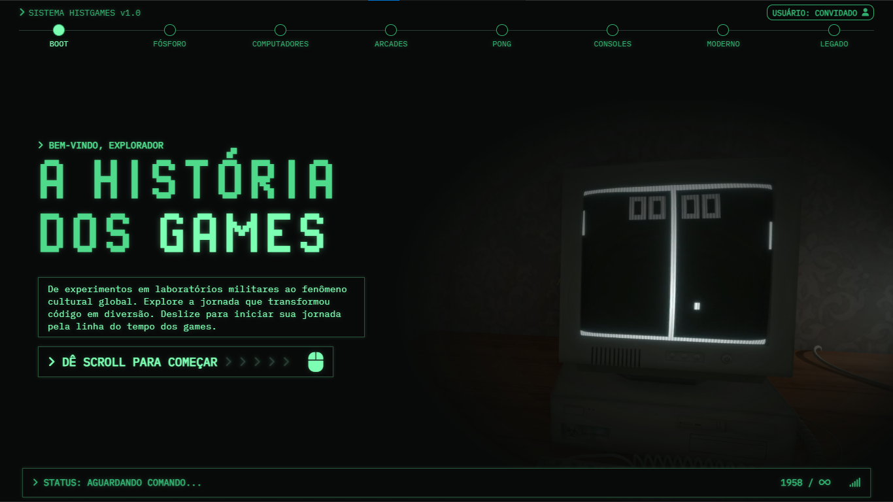
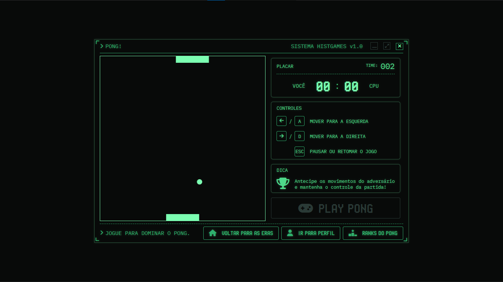
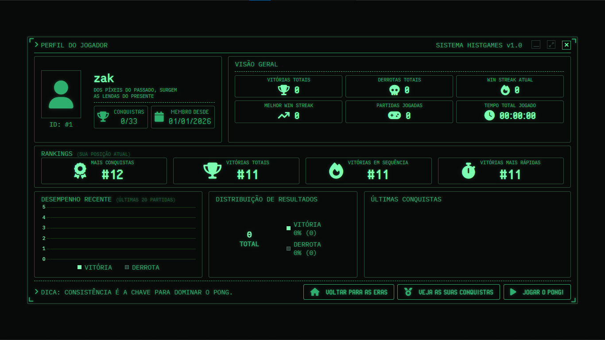
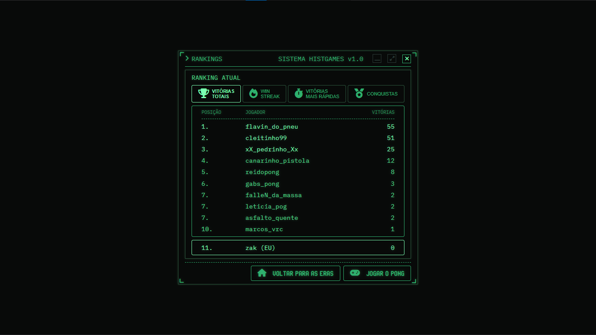
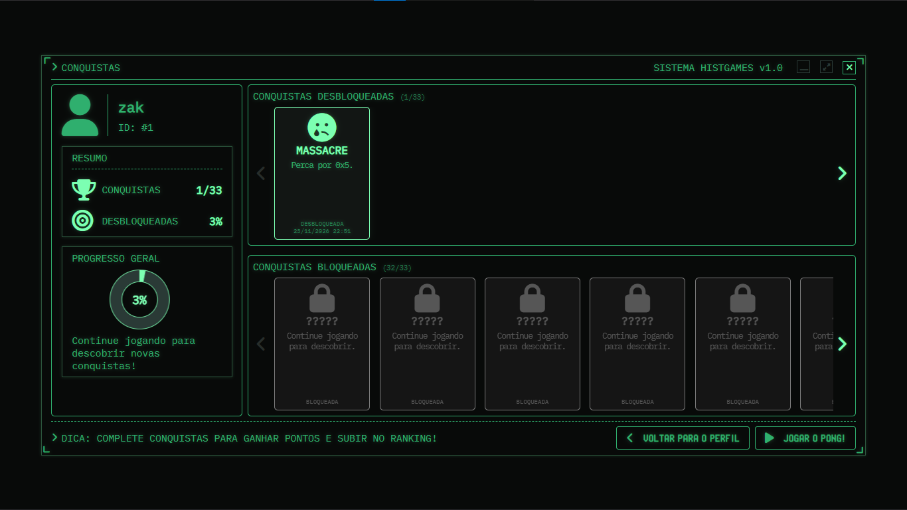

# 🎮 História dos Games

> **“Os jogos que marcaram gerações começaram como simples experimentos em telas limitadas. Hoje, eles contam histórias, criam memórias e inspiram pessoas — inclusive eu.”**

<p align="center">
  
  
</p>

**História dos Games** é um projeto web concluído que transforma a evolução dos videogames em uma experiência interativa: navegação por eras, estética retrô e um Pong jogável dentro do próprio site.

⚡ **8 eras** · **33 conquistas** · **4 rankings** · **1 minigame jogável**

## 📸 Prévia

<p align="center">
  
</p>

<table>
  <tr>
    <td width="50%" align="center"><b>🎮 Pong jogável</b><br></td>
    <td width="50%" align="center"><b>📊 Perfil e gráficos</b><br></td>
  </tr>
  <tr>
    <td width="50%" align="center"><b>🏆 Rankings</b><br></td>
    <td width="50%" align="center"><b>🏅 Conquistas</b><br></td>
  </tr>
</table>

## 📖 Sobre o Projeto

A ideia surgiu da vontade de unir jogos e programação. Em vez de contar a história dos games no formato tradicional, o site coloca o usuário dentro dessa jornada: interface de terminal retrô, animações, transições entre eras e um minigame integrado. Tudo feito com tecnologias web, sem engines externas.

## 🕹️ Funcionalidades

- ✅ Cadastro e login de usuários
- ✅ Perfil com estatísticas e gráficos de desempenho
- ✅ Rankings (vitórias, win streak, vitórias rápidas e conquistas)
- ✅ Sistema de conquistas desbloqueadas automaticamente
- ✅ Histórico de partidas
- ✅ Navegação interativa pelas eras dos videogames
- ✅ Pong jogável diretamente no navegador

## 🏆 Sistema de Conquistas

As conquistas são verificadas automaticamente após cada partida e exibidas durante a gameplay. Alguns exemplos: vencer partidas, alcançar win streaks, vencer sem sofrer pontos, partidas rápidas, viradas históricas e tempo total jogado.

## 🎨 Visual do Projeto

A interface mistura terminais retrô, arcades clássicos, cyberpunk, neon e pixel art. O resultado é um "console futurista retrô": nostalgia dos sistemas antigos com uma identidade moderna.

## 🛠️ Tecnologias Utilizadas

**Frontend**

   

**Backend & Banco de dados**

  

## 🚀 Como executar

**Pré-requisitos:** Node.js e MySQL instalados.

```bash
npm install
# configure o .env.dev com os dados do MySQL (veja .env.dev.example)
npm start
```

Acesse `http://localhost:3333`. Para alternar entre desenvolvimento e produção, ajuste a seleção do arquivo de configuração no topo do `app.js`.

## ❤️ Conexão Pessoal

Os jogos sempre foram meu primeiro contato com tecnologia e criatividade. Muito antes de entender programação, eu já queria descobrir como aqueles sistemas funcionavam por trás das telas.

Esse projeto acabou se tornando uma forma de juntar essa curiosidade antiga com tudo que venho aprendendo no desenvolvimento de software.

---

🎓 Feito na **São Paulo Tech School** · 📄 Licença [MIT](LICENSE)
